# Cryptography Practical Lab Logbook

**Module:** CSN09112 — Network Security and Cryptography  
**Lab reference:** [Week 6 — Public Key Cryptography labs](https://github.com/billbuchanan/csn09112/tree/master/week06_public_key/labs)  
**Platform:** Kali Linux (OpenSSL/Python) and AWS lab environment  
**Evidence:** 18 annotated screenshots across 6 exercise sections  
**Lab sessions:** 16 and 19 October 2026 (based on screenshot filenames and terminal output)

## Aim

Document practical key exchange, RSA encryption, certificate generation, AWS KMS encryption and digital signatures, and symmetric block cipher experiments. The commands and outputs below are based on screenshots captured during the exercises, including troubleshooting and failed attempts where visible.

## Contents

1. [Diffie–Hellman key exchange](#1-diffiehellman-key-exchange)
2. [RSA key generation, encryption and decryption](#2-rsa-key-generation-encryption-and-decryption)
3. [Certificate signing requests and X509 certificates](#3-certificate-signing-requests-and-x509-certificates)
4. [AWS KMS: authentication and asymmetric encryption](#4-aws-kms-authentication-and-asymmetric-encryption)
5. [AWS KMS digital signing and independent verification](#5-aws-kms-digital-signing-and-independent-verification)
6. [Symmetric block cipher demonstrations (ECB and CBC)](#6-symmetric-block-cipher-demonstrations-ecb-and-cbc)
7. [Conclusion](#conclusion)

> **Publication safety:** Images 02 and 03 have sensitive private RSA key bytes removed. Never upload `private.pem`, `key3des.pem`, AWS credentials, or other secrets to a public repository. Screenshots may contain lab account identifiers and key IDs (not authentication secrets); review these if institutional policy requires their removal. This repository contains evidence images and Markdown, not credential or key files.

## 1. Diffie–Hellman key exchange

The Python experiment used the shared base `2879` and modulus `9929`. Bob chose private exponent `6`, while Alice chose `9`.

```python
bob_public = pow(2879, 6, 9929)        # 4850
alice_public = pow(2879, 9, 9929)      # 3614
bob_shared = pow(alice_public, 6, 9929) # 4868
alice_shared = pow(bob_public, 9, 9929) # 4868
```

**Result:** Both parties calculated `4868`, demonstrating the shared-secret property of Diffie–Hellman. These small, illustrative parameters are not suitable for secure deployment.

### Screenshot evidence

**Figure 1.** Matching Diffie–Hellman shared secrets in Python.

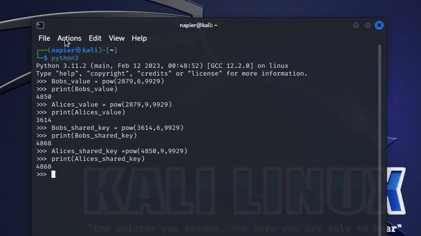


## 2. RSA key generation, encryption and decryption

I generated a 1024-bit RSA private key and inspected its mathematical components with OpenSSL:

```bash
openssl genrsa -out private.pem 1024
cat private.pem
openssl rsa -in private.pem -text -noout
```

The inspection showed a **1024-bit, two-prime RSA key** with public exponent **65537**, alongside the modulus, private exponent, prime factors and Chinese Remainder Theorem (CRT) parameters. The PEM-encoded private key and its private mathematical components have been **redacted in the published screenshots**.

I then created a passphrase-protected copy of the private key and exported its public key:

```bash
openssl rsa -in private.pem -des3 -out key3des.pem
openssl rsa -in private.pem -out public.pem -outform PEM -pubout
cat public.pem
nano myfile.txt
```

The first encryption attempts showed a misspelled `pkeyutl` command and a failure to identify `public.pem` as a public key. The corrected commands were:

```bash
openssl pkeyutl -encrypt -inkey public.pem -pubin -in myfile.txt -out file.bin
openssl pkeyutl -decrypt -inkey private.pem -in file.bin -out decrypted.txt
cat decrypted.txt
```

One earlier attempt failed with an RSA padding error; after encrypting again with the correct options, decryption succeeded. The recovered message was:

```text
hello you have stumbled apon my secret message
```

**Result:** RSA public-key encryption and private-key decryption recovered the original plaintext. RSA-1024 is obsolete for security-sensitive applications; modern deployments should use stronger keys, RSA-OAEP and preferably hybrid encryption for substantial files.

### Screenshot evidence

**Figure 2.** Generation of RSA private key; private key data redacted.

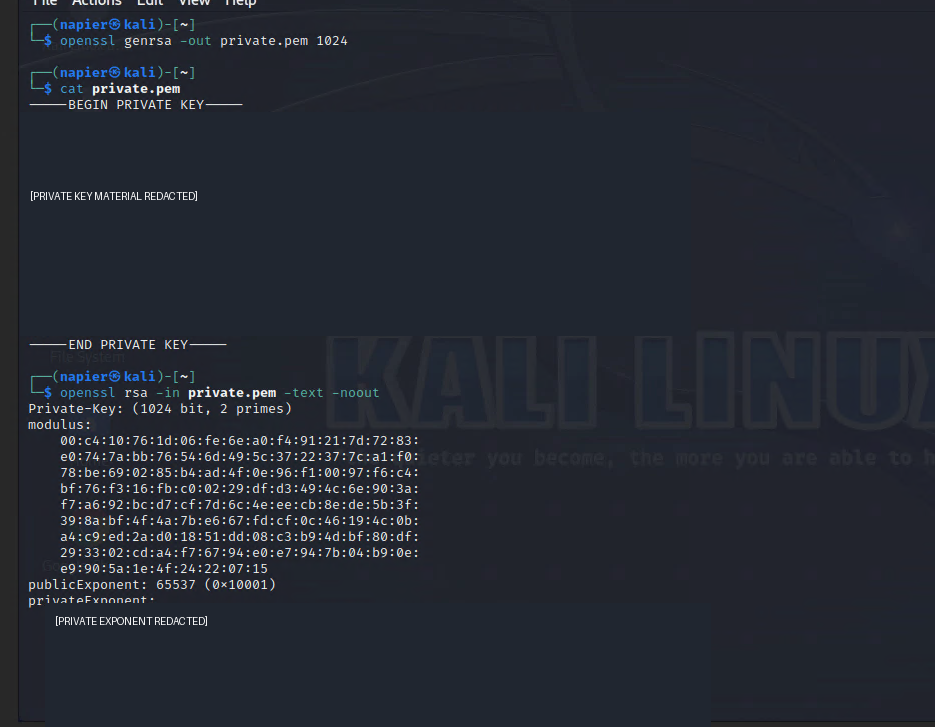

**Figure 3.** RSA internal key parameters; private values redacted.

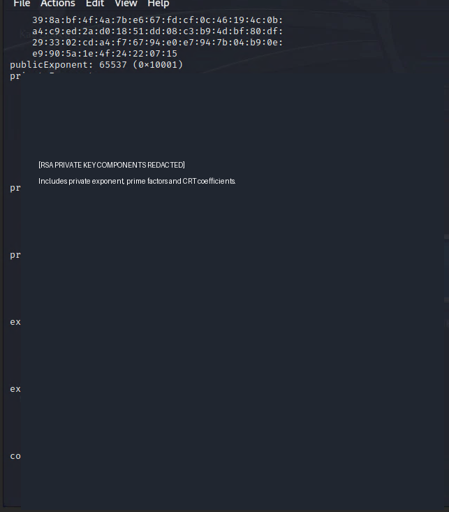

**Figure 4.** Public key export and troubleshooting initial encryption/decryption attempts.

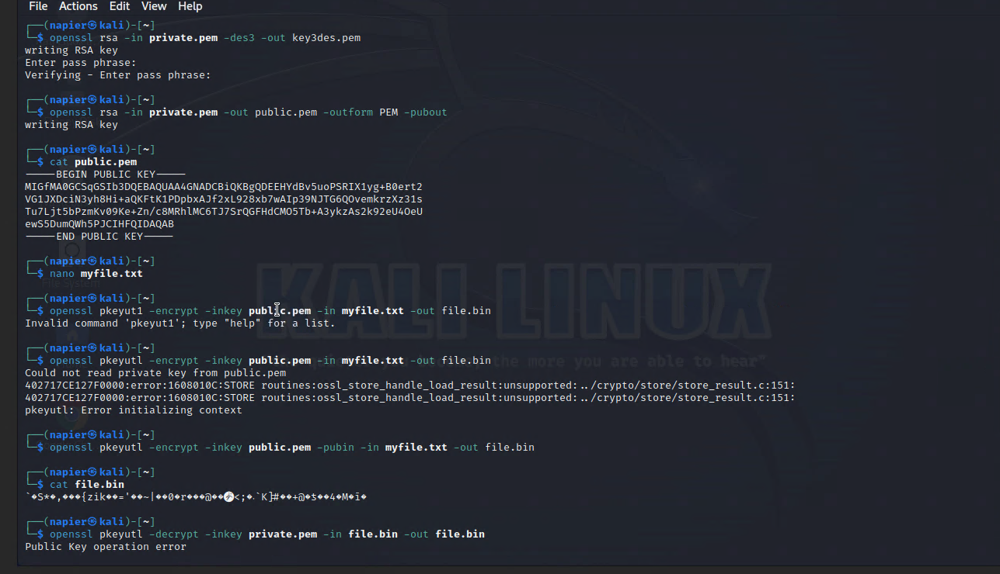

**Figure 5.** Successful decryption and recovery of the original message.

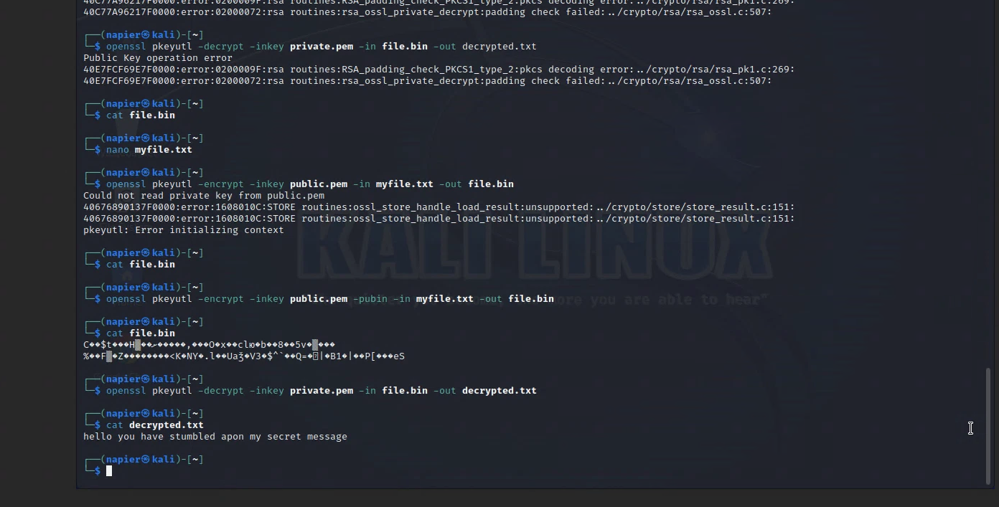


## 3. Certificate signing requests and X.509 certificates

Using the RSA private key, I created and inspected a Certificate Signing Request (CSR):

```bash
openssl req -new -key private.pem -out cert.csr
openssl req -in cert.csr -text -noout
```

The subject fields recorded were **C=GB, ST=Scotland, L=Edinburgh, O=Napier, OU=IT, CN=localhost**. The CSR contained a **1024-bit RSA public key**, public exponent **65537**, no requested extensions and a **sha256WithRSAEncryption** signature. A CSR proves possession of the corresponding private key but does not itself validate the asserted identity.

I then generated and inspected a self-signed certificate:

```bash
openssl x509 -req -in cert.csr -signkey private.pem -out server.crt
openssl x509 -in server.crt -text -noout
```

OpenSSL reported `Certificate request self-signature ok`. The resulting certificate was **X.509 version 1**, with matching issuer and subject and validity from **16 October 2026 11:23:26 GMT** to **15 November 2026 11:23:26 GMT**. It used RSA-1024 with SHA-256/RSA signatures.

**Result:** A self-signed certificate was created and inspected successfully. Self-signed certificates are not automatically trusted by browsers, and this v1 certificate lacks a Subject Alternative Name (SAN), making it unsuitable as a modern production TLS server certificate.

### Screenshot evidence

**Figure 6.** CSR generation and subject Distinguished Name.

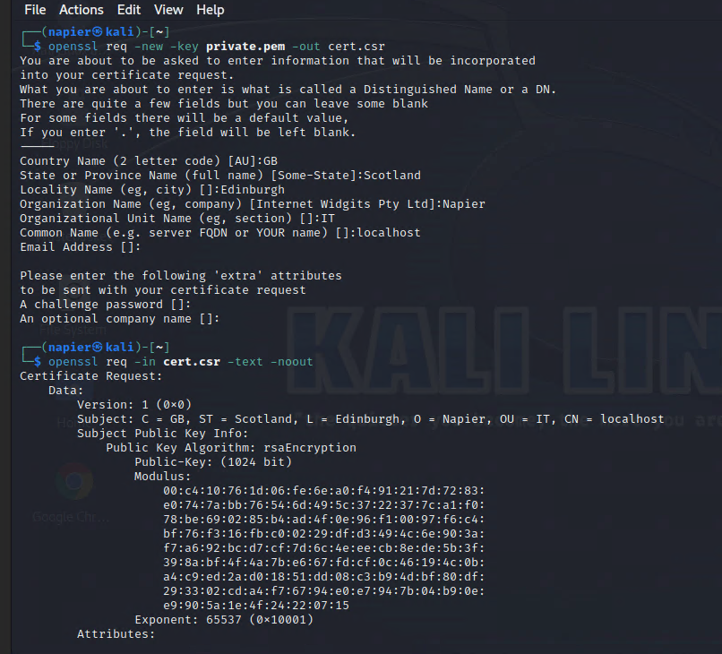

**Figure 7.** CSR signature algorithm, public-key information and signature.

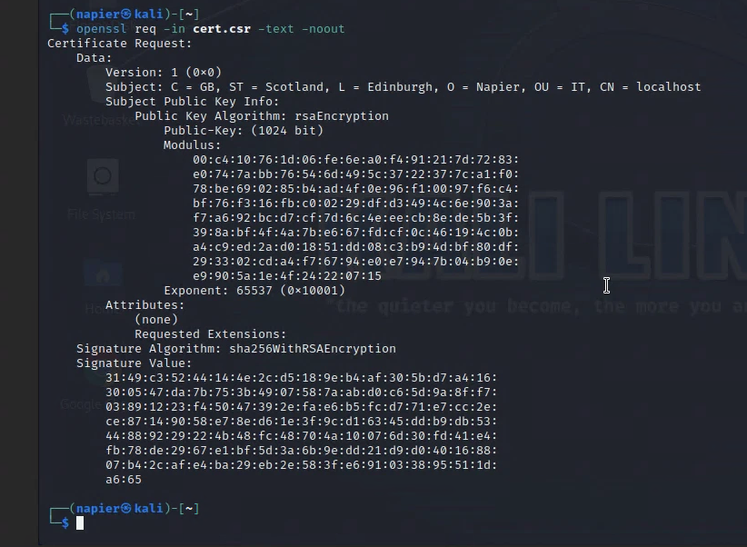

**Figure 8.** Self-signed X.509 certificate generation and inspection.

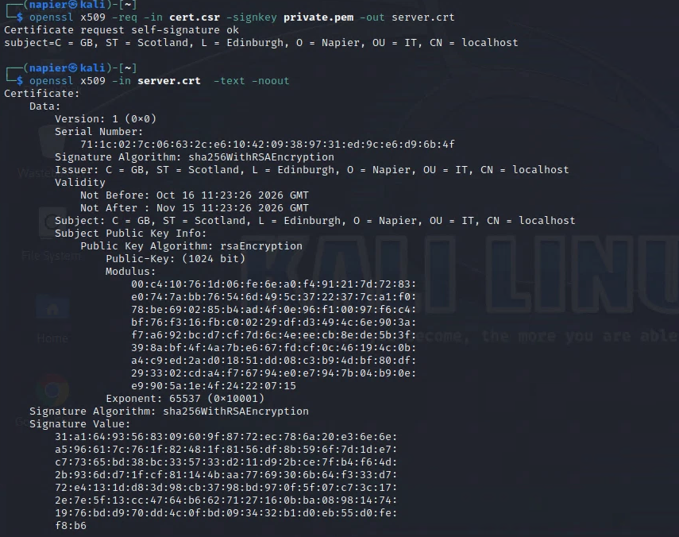


## 4. AWS KMS: authentication and asymmetric encryption

Initial AWS CLI calls to `aws sts get-caller-identity` returned `ExpiredToken`. I selected the lab credentials file and cleared environment variables that could override the chosen profile:

```bash
export AWS_SHARED_CREDENTIALS_FILE="$HOME/lab-credentials"
export AWS_PROFILE=default
unset AWS_ACCESS_KEY_ID
unset AWS_SECRET_ACCESS_KEY
aws sts get-caller-identity
aws kms get-public-key --key-id alias/PublicKeyForDemo
```

The subsequent authentication and public-key retrieval succeeded. The KMS key was an **RSA_2048** key with **ENCRYPT_DECRYPT** usage and supported `RSAES_OAEP_SHA_1` and `RSAES_OAEP_SHA_256`.

I created `1.txt` and encrypted/decrypted its contents using KMS:

```bash
nano 1.txt
aws kms encrypt --key-id alias/PublicKeyForDemo --plaintext fileb://1.txt --query CiphertextBlob --output text --encryption-algorithm RSAES_OAEP_SHA_1 > 1.out
base64 -i 1.out --decode > 1.enc
aws kms decrypt --key-id alias/PublicKeyForDemo --ciphertext-blob fileb://1.enc --encryption-algorithm RSAES_OAEP_SHA_1 --query Plaintext --output text > 2.out
base64 -i 2.out --decode
```

**Recovered message:** `This is my super secret file.`

Next, I edited and ran the Python demonstration:

```bash
nano 1.py
python3 -W ignore 1.py
```

The script displayed `Plaintext: Hello`, a ciphertext value, and `Plain: Hello`. The screenshot shows the program's outputs, not its source code; its internal library and implementation are therefore not asserted here.

**Result:** Asymmetric encryption and decryption worked from both the AWS CLI and the Python script. AWS KMS retains control of the private key; the displayed `PublicKey` output is public information. For new designs, RSA-OAEP with SHA-256 is preferable to SHA-1.

### Screenshot evidence

**Figure 9.** Expired-token troubleshooting, successful AWS authentication and public-key retrieval.

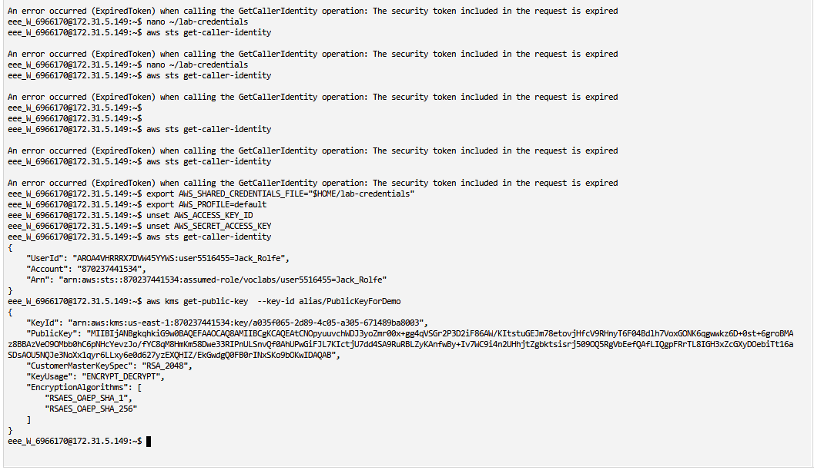

**Figure 10.** KMS CLI encryption, ciphertext decoding and plaintext recovery.

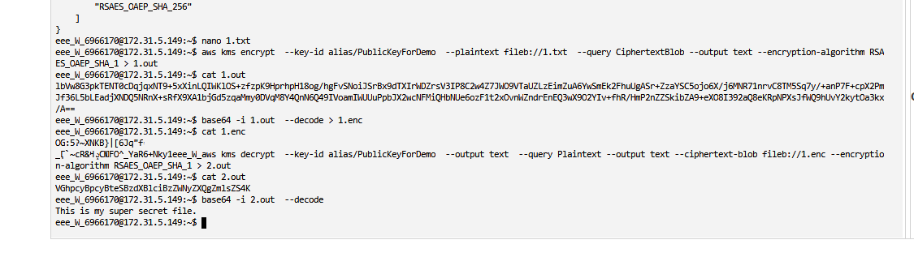

**Figure 11.** Python script encrypting and decrypting the message Hello.

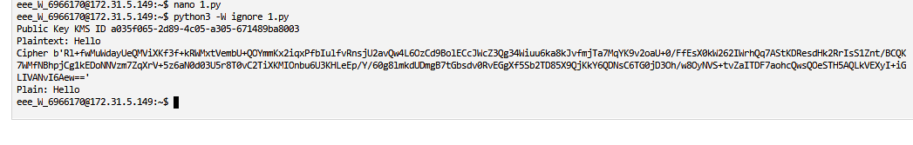


## 5. AWS KMS digital signing and independent verification

I created a KMS signing key with key specification `RSA_2048` and usage `SIGN_VERIFY`:

```bash
aws kms create-key --customer-master-key-spec RSA_2048 --key-usage SIGN_VERIFY --description "My RSA Key Pair"
```

An early `aws kms sign` request used the wrong key ID and produced `NotFoundException`. Repeating the operation with the newly created key successfully generated a signature. Below, `<SIGNING_KEY_ID>` stands for the actual key ID displayed in the terminal; it is a placeholder, not a literal value to run.

```bash
aws kms sign --key-id <SIGNING_KEY_ID> --message fileb://1.txt --signing-algorithm RSASSA_PKCS1_V1_5_SHA_256 --query Signature --output text > 1.out
base64 -i 1.out -d > 1.sig
aws kms verify --key-id <SIGNING_KEY_ID> --message fileb://1.txt --signature fileb://1.sig --signing-algorithm RSASSA_PKCS1_V1_5_SHA_256
```

AWS KMS returned **`"SignatureValid": true`**. I then exported the signing key's public component from KMS and converted its DER encoding to PEM:

```bash
aws kms get-public-key --key-id <SIGNING_KEY_ID> --output text --query PublicKey | base64 --decode > mycert.der
openssl rsa -pubin -inform DER -outform PEM -in mycert.der -pubout -out mycert.pem
cat mycert.pem
openssl dgst -sha256 -verify mycert.pem -signature 1.sig 1.txt
```

OpenSSL returned **`Verified OK`**. Despite its name, `mycert.pem` contains a **public key**, not a certificate.

**Result:** The RSA signature made by AWS KMS was verified both within KMS and independently with OpenSSL. This demonstrates integrity verification and interoperability; a verified signature alone does not establish real-world identity unless the public key is trusted.

### Screenshot evidence

**Figure 12.** RSA signing-key creation and correction of a key-ID error.

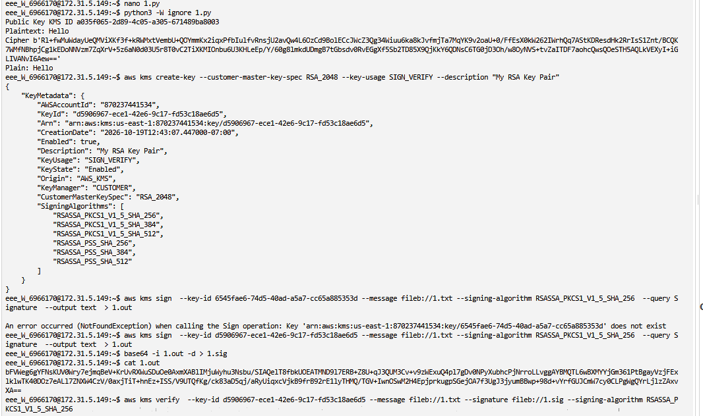

**Figure 13.** AWS KMS signature verification returning SignatureValid: true.

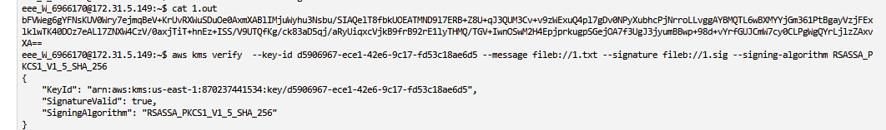

**Figure 14.** Exporting the KMS signing public key in DER form.

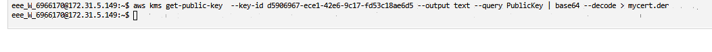

**Figure 15.** Converting public key from DER to PEM format.

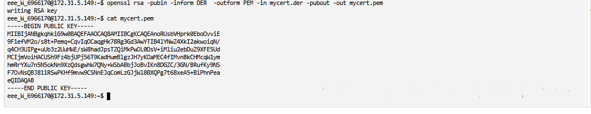

**Figure 16.** OpenSSL verifies the KMS-generated signature: Verified OK.

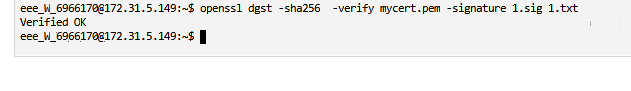


## 6. Symmetric block cipher demonstrations (ECB and CBC)

I used `cipher01.py` with several plaintext/key inputs. The script displayed the message before padding, a padded byte string, the ciphertext and the recovered message. The screenshots do not show the source code, so exact key derivation and IV handling cannot be independently assessed.

**ECB-mode tests (Figure 17):**

```bash
nano cipher01.py
python cipher01.py hello mykey
python cipher01.py inkwell mykey
python cipher01.py inkwell orange
python cipher01.py secure qwerty
python cipher01.py Africa changeme
```

All five runs recovered their original messages (`hello`, `inkwell`, `inkwell`, `secure`, `Africa`). ECB encrypts blocks independently and may reveal repeated plaintext patterns. The screenshot labels its ciphertext `Cipher (ECB)`.

**CBC-mode tests (Figure 18):**

```bash
nano cipher01.py
python cipher01.py hello hello123
python cipher01.py inkwell orange
python cipher01.py security qwerty
python cipher01.py Africa changeme
```

All four runs recovered the original messages (`hello`, `inkwell`, `security`, `Africa`). The terminal labels the output `Cipher (CBC)` and `After padding (CMS)`; the padding bytes resemble PKCS#7-style padding. CBC chains ciphertext blocks and requires an appropriate IV. **Neither ECB nor CBC alone provides authenticated encryption**; AES-GCM is commonly preferred for new applications.

**Result:** Each observed encryption/decryption run successfully recovered the entered plaintext; changing the plaintext or supplied key input changed the ciphertext.

### Screenshot evidence

**Figure 17.** ECB-mode tests with different plaintext and key inputs.

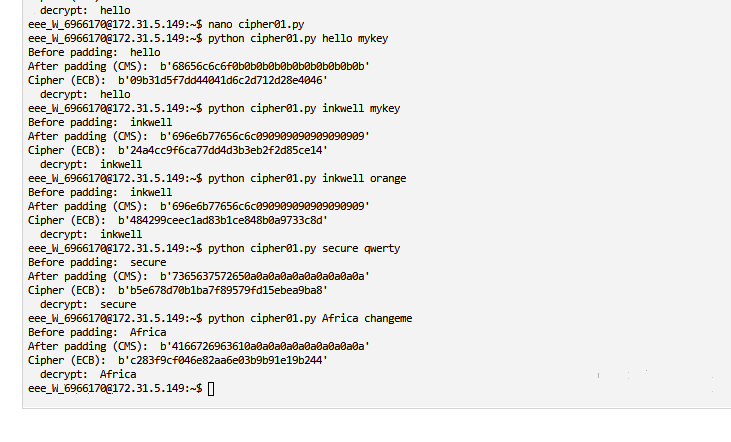

**Figure 18.** CBC-mode tests with padding, encryption and successful decryption.

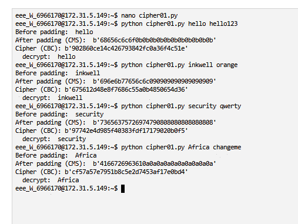

## Conclusion

The practical exercises demonstrated that Diffie–Hellman can produce matching shared secrets; RSA public/private keys can encrypt and decrypt short messages; CSRs and self-signed X.509 certificates can be generated with OpenSSL; AWS KMS supports managed RSA encryption and digital signing; and signatures generated in KMS can be independently checked using OpenSSL. The symmetric encryption tests also illustrated block padding and differences between ECB and CBC modes.

Failures were retained as evidence of troubleshooting: a misspelled OpenSSL command, missing `-pubin`, an RSA padding error, an expired AWS token, and an incorrect KMS key ID. Their subsequent corrections were visible in the screenshots. Successful decryption and signature verification are supported by the displayed terminal outputs.

**Security considerations:** Lab RSA-1024 keys and short demo parameters are not production secure. Self-signed certificates are not automatically trusted, ECB leaks patterns, CBC does not authenticate messages, and RSA-OAEP with SHA-256 is preferable to SHA-1 for new applications. Cryptographic keys and credentials must not be committed to GitHub.

## Source and evidence notes

- Original practical materials: [CSN09112 Week 6 public-key labs](https://github.com/billbuchanan/csn09112/tree/master/week06_public_key/labs).
- Explanations reflect observed screenshot evidence; script source files were not provided and are not reproduced.
- The `screenshots/` directory contains sequential, locally referenced images so that GitHub renders them directly in this README.
